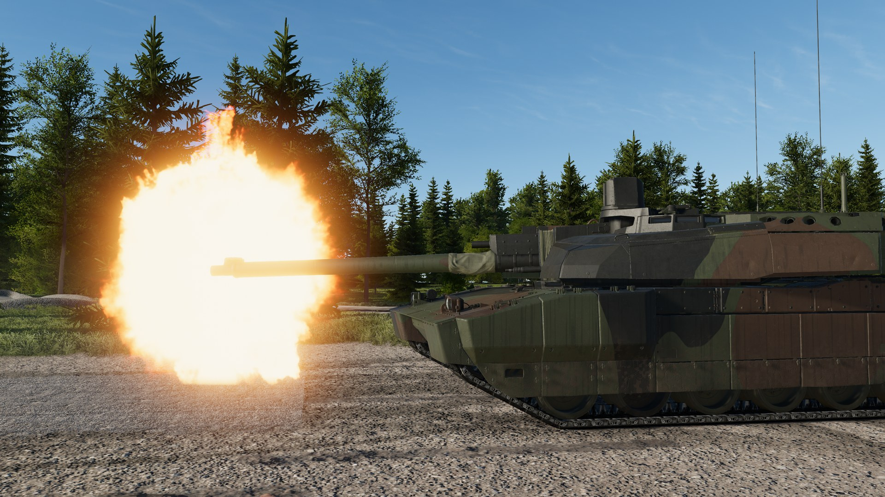
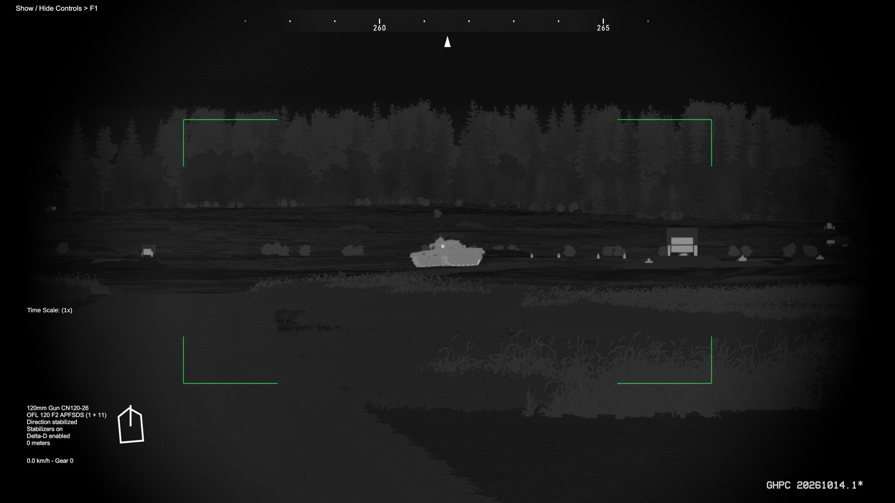
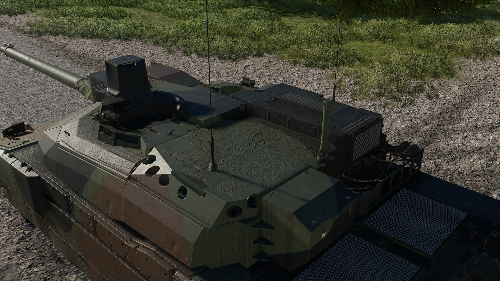

# Leclerc SXXI for Gunner, HEAT, PC!

> [!NOTE]
> The Leclerc is still being worked on, so a few things can change between versions. If something looks or behaves
> wrong, tell me (see [Bugs and suggestions](#bugs-and-suggestions)).

A French **Leclerc SXXI** you can drive and fight in GHPC, as its own unit on the NATO side. The bustle autoloader with
its conveyor, the HL 130 gunner's sight with its Iris thermal, the HL 120 secours emergency view, OFL 120 F2 darts, the
12.7 mm coax, GALIX smoke and the V8X diesel.

I made this mod for myself first, but you're welcome to use it too.

It's a separate mod from my other tanks, you don't need any of them for it, and they all work fine installed together.

<p align="center">
  
  
</p>

This README describes **version 0.1.0**. No other mod needed, just MelonLoader.

## Installing it

1. Get [MelonLoader](https://github.com/LavaGang/MelonLoader/releases) (0.7.3 or newer) into GHPC if you don't have it already.
2. Download `LeclercSXXI_<version>.zip` from [Releases](../../releases/latest).
3. Copy the `Mods` folder from the zip into the game folder, the one with `GHPC.exe` in it (Steam: right-click GHPC >
   Manage > Browse local files). You should end up with:
   ```
   Mods\LeclercSXXI.dll
   Mods\LeclercSXXI\leclercsxxi
   ```
4. Start the game. The Leclerc is in **Instant Action** (unit "Leclerc SXXI"), in the mission editor and in the
   "Showcase of most playable vehicles" mission. It isn't in the campaign rosters.

To remove it, delete `Mods\LeclercSXXI.dll` and the `Mods\LeclercSXXI` folder.

## What's in it

- **The bustle autoloader**: 22 rounds on a conveyor that turns until the round you picked reaches the loading door,
  6 s a reload, 8 s when you change round type. 18 more in the hull drum, which the crew moves up to the bustle.
- **Armour built for GHPC**: the SXXI's turret modules, the NERA boxes on the bustle sides, and blow-off panels in the
  bustle roof.
- **The HL 130** for the gunner, day channel, Iris thermal and laser, and **an emergency view through the commander's
  HL 120** for when the gunner's sight is gone.
- **French rounds**: OFL 120 F2 and F1 darts, OECC HEAT-MP and the EXPL HE with an overhead burst setting, in white
  cases with the French bands and stencils.
- **The 12.7 mm M2HB coax** and **14 GALIX tubes**.
- **The V8X diesel**, 1500 hp, 72 km/h forward and 40 km/h in reverse.

## A bit of history

The SXXI (Série XXI, also called the third series) is the last batch of Leclercs built for the French Army, tranches
10 and 11, about 96 tanks delivered from 2003 to 2007. It kept the HL 130 gunner's sight the later second-series tanks
already had, and added the HL 120 commander's sight with its own thermal in place of the old HL 70, add-on armour
modules on the turret front and sides, and from tranche 11 the ICONE tactical computer. All the SXXIs were brought up to
the tranche 11 standard from 2007.

The tank in this mod is an SXXI as it served before the XLR upgrade, in the three-tone Centre-Europe camouflage.

## The Leclerc next to the game's tanks and my T-90A

GHPC's newest NATO tanks are the Leopard 2A3 and the M1IP, both 20 years older than an SXXI, so it's stronger than both,
as it should be. Against my T-90A it's a fair match: neither gets through the other's turret front.

| | Leopard 2A3 (vanilla) | M1IP (vanilla) | **Leclerc SXXI (this mod)** | [T-90A](https://github.com/marsattackk/GHPC-T90A) (my mod) |
|---|---|---|---|---|
| Turret front (vs APFSDS / HEAT) | 403 / 771 | 516 / 999 | **700 / 1100** | 690 / 819, plus Kontakt-5 (about +140 / +550) |
| Upper glacis (vs APFSDS / HEAT) | 317 / 661 | 348 / 361 | **500 / 800** | 549 / 748 |
| Best dart | DM23, 520 mm | M833, 480 mm | **OFL 120 F2, 800 mm** | 3BM60, about 690 mm |
| Reload | loader | loader | **6 s, 8 s on a type change** | 6.5 s |
| Rounds | 42 | 55 | **40** (22 ready) | 42 (22 ready) |
| Mass, power | 55.3 t, 1400 hp | 55.3 t, 1519 hp | **57.7 t, 1500 hp** | 46.5 t, 1000 hp |
| Top speed, reverse | 75 / 40 km/h | 72 / 40 km/h | **72 / 40 km/h** | 60 / 4.2 km/h |

The armour figures are what a round meets coming straight from the front. The Leclerc's 700 / 1100 is its left cheek,
the right one is a lot stronger (about 1150 / 1780) because it has a second pack beside the gunner. The weak spot from
the front is the seam round the gunner's sight block.

## "It's a War Thunder model, does it even work in GHPC?"

Yes. The looks come from War Thunder, and so do the **shapes** of the armour plates, because War Thunder's damage model
is a pretty good map of where every plate sits. What those plates are worth, and everything else that decides what
happens when a round hits, was built for GHPC with GHPC's own rules.

<details>
<summary><b>How it's built for GHPC</b></summary>

- **The armour values are mine, not War Thunder's.** The front packs are set to what the SXXI was designed to stop.
  The rest are my estimates from French sources and tanks of the same period, marked as guesses in my notes.
- **It's built on the vanilla T-80B**, like my T-80UM2: its running gear, hull internals and the gun and sight systems
  underneath, with the Leclerc's values and looks on top. Where you see or hear it, a NATO tank gets NATO parts: the
  rounds are the game's Leopard 2 rounds reshaped and repainted, the gun sound and the engine are the Leopard 2's (with
  a turbine whine under the diesel), the gunner's reticle is the M1 / Leopard 2 one and the crew talk like Americans.
- **The inside works like a vanilla tank.** Crew, the bustle rack, the hull drum and the fuel tanks sit where they are in
  a Leclerc. Engine, transmission, cooling, the breech, both drives, the power system, the fire control, the HL 130,
  the HL 120 head and the rammer are damageable modules wired into the game's own systems, so knocking one out does what
  it does on a vanilla tank.
- **The bustle is its own compartment.** A hit that sets the rack off blows the two roof panels and the crew in front
  of the bulkhead lives.

</details>

<p align="center">
  
  
</p>

*Left: the turret front from the commander's side, the HL 120 head on top. Right: the hit x-ray from above, the crew
light blue, the 22-round bustle rack at the back of the turret.*

## The autoloader

The 22 rounds in the bustle sit in cells on an endless chain. When you ask for a round type the chain runs until the
next round of that type is at the door, the door opens, the rammer pushes it in through the gutter and pulls back, and
the door and breech close. That takes 6 s, or 8 s when the type changes. The gun dips to -1.8° to load and comes back
up to where the fire control wants it, the sight stays where you put it.

The crew moves rounds from the hull drum up to the bustle, about 22 s each. Loading the gun comes first: a transfer
waits while the gun loads and then carries on.

## The sights

<p align="center">
  
  
</p>

*Left: the HL 130 day channel. Right: the HL 130's Iris thermal at night.*

- **HL 130** (gunner): day channel at 17.5° / 5.5°, Iris thermal at x3 / x10 / x20, laser rangefinder to 6000 m.
- **HL 120 secours**: the commander's HL 120 head slaved to the gun with an emergency reticle, one range scale per
  round, no laser and no computer, you set the range. It's in the gunner's view cycle, and it's where you end up when
  the HL 130 gets knocked out. The real tank has no backup gunner's sight, the commander takes over through his.
- **The commander** has the free-look view and night-vision goggles for now, like the game's Leopard and Abrams. The
  HL 120 head is on the turret and can be knocked out, but it isn't a sight of its own yet, apart from the secours view.

<p align="center">
  
  
</p>

*Left: the secours view with its range scales, close up. Right: the bustle roof, the two blow-off panels on the left of
it and the GALIX tubes along the side.*

## The ammo

| Round | Type | Speed | Penetration |
|---|---|---|---|
| OFL 120 F2 | APFSDS (default) | 1740 m/s | about 800 mm |
| OFL 120 F1 | APFSDS | 1790 m/s | about 700 mm |
| OECC 120 F1 | HEAT-MP | 1100 m/s | 560 mm |
| 120 EXPL F1 | HE | 1050 m/s | 3.5 kg of TNT equivalent |

18 darts, 14 HEAT and 8 HE. The mission's ammo menu picks which dart you carry. The EXPL's fuze is in the vehicle menu
("120 EXPL F1 fuze"): impact, or a burst about 3 m over the lased range, set when the round loads.

The coax is a 12.7 mm M2HB with 950 rounds in belts of 140.

## How much of it is real

**From French sources** (the Army's and the maker's documents, books on the Leclerc, the French wiki's tranche tables):
- The crew places, the 22 + 18 rounds, the reload times, the gun limits (-8 / +20°) and drive speeds, the HL 130's
  fields, the Iris, the 12.7 mm coax and its 950 rounds, the 14 GALIX tubes, the mass, the 1500 hp, 72 km/h and the
  38 km/h fast reverse, and the 1300 l of fuel.
- What the front armour was built to stop, and that the bustle boxes are non-explosive.

**Borrowed or worked out**:
- The OFL F1's penetration is worked out from its rod, the F2's is the F1 plus the 10-15 % the sources give it. The
  OECC's is the game's DM12A1, the French figure has no known origin.
- The secours view's fields are the HL 70's.
- The reverse is 40 km/h like the game's Leopard and Abrams instead of the sourced 38.

**My guesses**, each marked as a guess in my notes:
- **The round mix**, 18 / 14 / 8. Nobody publishes it.
- **The gunner's reticle**: the game's M1 / Leopard 2 one, I haven't found a picture of the HL 130's. The secours
  reticle is my own layout from a description.
- **The x20 thermal field**, the laser's range, the glacis value, the skirts, the welded plates and the plates round the
  gun.
- **The EXPL's explosive**: 3 kg of Comp B worked up to TNT the way the game does it for its own rounds.
- **The conveyor's cells, door and rammer timings**, from photos, and the restock time.
- **The inside**: where the modules, fuel tanks and bulkhead go.

If you've got a real source on any of that, I'd genuinely love to see it.

## Known limits

- The game has no French army, so it fights on the US side with American voices.
- The commander's HL 120 isn't a working sight of its own yet, only the secours view uses it.
- All 14 GALIX tubes fire in one volley, and GHPC has no smoke restock, so you get one screen per tank.

## Bugs and suggestions

I'm open to suggestions, fixes, better sources, pull requests, whatever you've got. If you know something about the real
Leclerc that the mod gets wrong, tell me.

Found a bug? Open an [issue](../../issues) and attach `MelonLoader\Latest.log` from the game folder. The mod writes a
warning there whenever something didn't load right, a game update has renamed something it uses, or one of its hooks
into the game failed (the game carries on without it).

I only make and test the mod on the current Steam version of GHPC. A cracked copy or an old build might not load it at
all, and I can't help with those, so make sure you're on the latest Steam version before opening an issue.

## More GHPC mods

I've made a few other mods for GHPC too, check out my [other repos](https://github.com/marsattackk?tab=repositories).

## Building from source

This repository holds the mod's C# source (.NET Framework 4.7.2). You need the .NET SDK (6 or newer) and GHPC with
MelonLoader installed (the build references the game's assemblies):

```
dotnet build -c Release -p:GameDir="<GHPC folder>\Bin"
```

`GameDir` is the folder with `GHPC.exe` in it (defaults to the usual Steam location). The DLL ends up in
`bin\Release\LeclercSXXI.dll`. The asset bundle (`Mods\LeclercSXXI\leclercsxxi`: model, textures, armour) isn't built
from this source, take it from the release zip.

Layout: `LeclercSXXI\` the mod, `Common\` the helpers it's built with, `Resources\` data embedded in the DLL.

## Where the model comes from, and the license

The 3D model, its textures and the shapes of its armour plates are War Thunder's Leclerc SXXI, taken from War Thunder's
game files. They belong to Gaijin Entertainment and they're not covered by this repository's license. Everything else
(the armour values, the autoloader, the sights, the secours reticle, the ammo, the interior) was built for GHPC, from
French sources and, where those ran out, my own best guesses.

The source code in this repository is under the [GNU General Public License v3.0](LICENSE).
