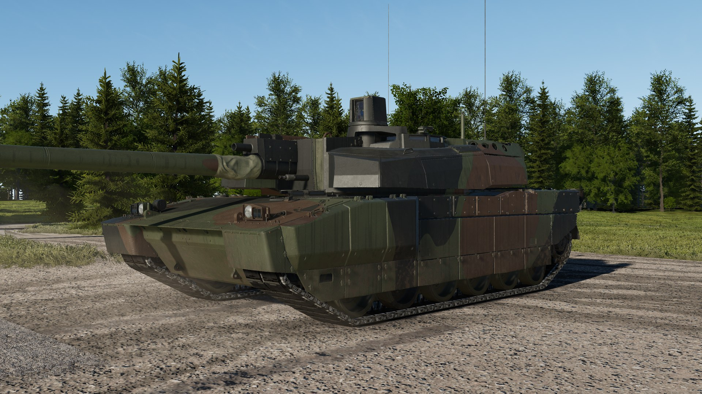
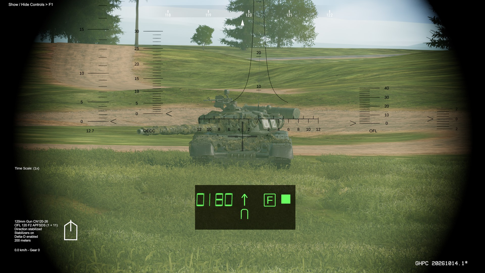
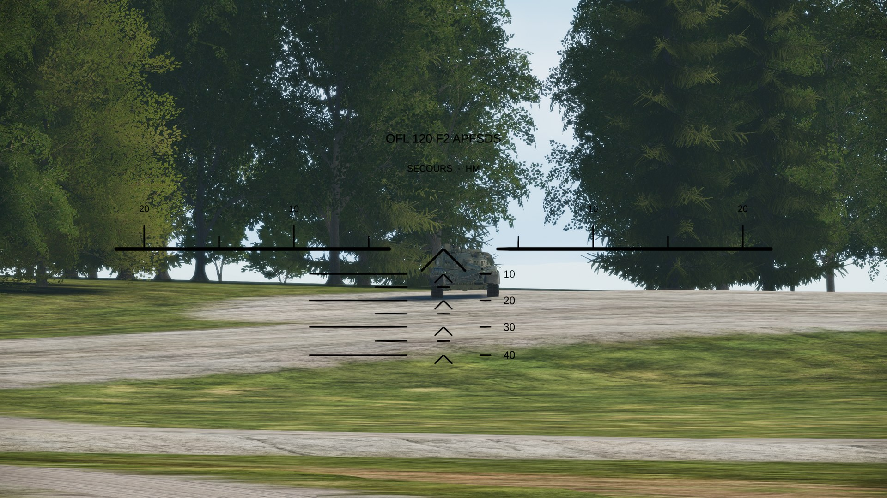
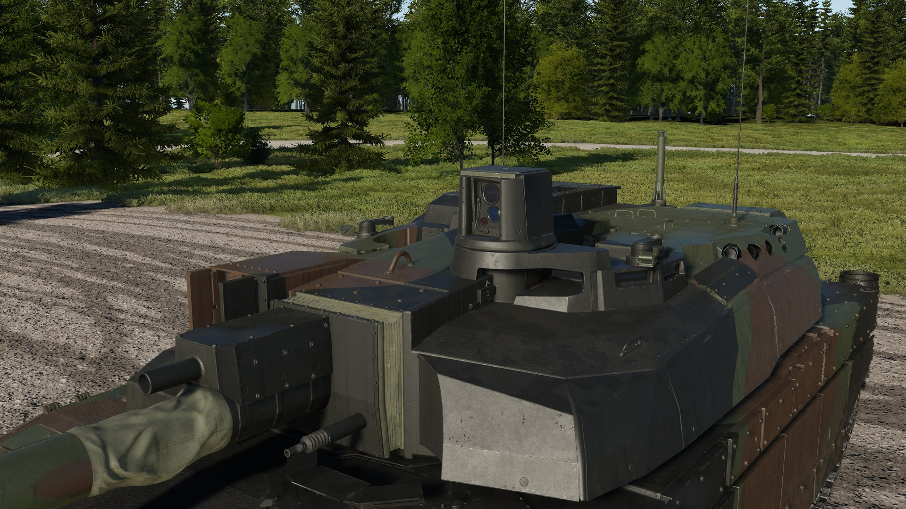
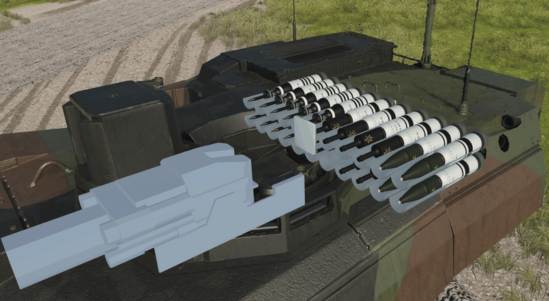
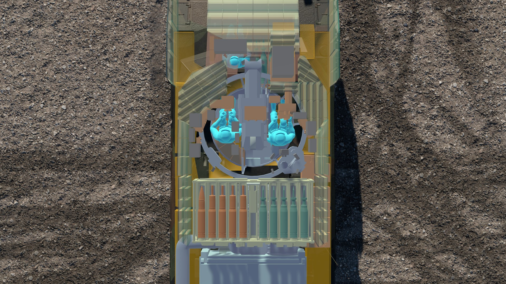

# Leclerc SXXI for Gunner, HEAT, PC!

A French **Leclerc SXXI** for GHPC, as its own unit on the NATO side. The bustle autoloader with its conveyor, the HL 130
gunner's sight with its Iris thermal, the HL 120 secours emergency view, OFL 120 F2 darts, a 12.7 mm coax, GALIX smoke
and the V8X diesel.

I made this mod for myself first, but you're welcome to use it too. It's still being worked on, so a few things can
change between versions. It's a separate mod from my [T-90A](https://github.com/marsattackk/GHPC-T90A),
[T-90M](https://github.com/marsattackk/GHPC-T90M) and [T-80UM2](https://github.com/marsattackk/GHPC-T80UM2), and they
all work fine installed together.

<p align="center">
  
  
</p>

## Installing it

1. Get [MelonLoader](https://github.com/LavaGang/MelonLoader/releases) (0.7.3 or newer) into GHPC if you don't have it
   already. No other mod is needed.
2. Download `LeclercSXXI_<version>.zip` from [Releases](../../releases/latest). It's about 185 MB, nearly all of it the
   model and textures.
3. Copy the `Mods` folder from the zip into the game's `Bin` folder, the one with `GHPC.exe` in it (Steam: right-click GHPC >
   Manage > Browse local files, then open `Bin`). `MelonLoader` and `UserData` are in there too. You should end up with:
   ```
   Mods\LeclercSXXI.dll
   Mods\LeclercSXXI\leclercsxxi
   ```
4. Start the game. The Leclerc is in **Instant Action** (unit "Leclerc SXXI"), in the mission editor, in the American
   side's campaign roster and in the "Showcase of most playable vehicles" mission. In the campaign it's about a quarter
   as common as a typical tank and turns up after two missions.

To remove it, delete `Mods\LeclercSXXI.dll` and the `Mods\LeclercSXXI` folder. That's safe mid-campaign too, because the
campaign save doesn't keep a list of units.

Once per game start the mod asks GitHub whether there's a newer release. If there is, you get one line with a link in
the MelonLoader console and that's it. Offline it stays quiet. `Check for updates` turns it off.

## Overview

The SXXI (Série XXI, also called the third series) is the last batch of Leclercs built for the French Army, about 96
tanks delivered from 2003 to 2007. Three crew and an autoloader in the bustle, a 120 mm gun, a 1500 hp diesel, the HL 130
gunner's sight and the HL 120 for the commander, with add-on armour on the turret front and sides. The one here is an
SXXI as it served before the XLR upgrade, in the three-tone Centre-Europe paint.

In GHPC it's about twenty years newer than anything on the NATO side, and it shows. From the front no dart or missile
in the base game gets through the turret cheeks: not the Leopard 2A3's DM23, not the M1IP's M833 and not the T-80B's
3BM32 or its Kobra. Its own OFL 120 F2 goes through all of their fronts. Against my [T-90A](https://github.com/marsattackk/GHPC-T90A)
it's a close match, each a little short of the other's turret front on my numbers. Below the turret it's a different
story, and the hull and the bustle are where you lose it (see [Armour protection](#armour-protection)).

If you've played the M1IP you'll know most of it already, and the
[official M1IP guide](https://gunnerheatpc.com/news/articles/gunnery-guide-m1ip) is worth a read. Keep a steady track,
lase, fire, and the computer does the rest. The ready rounds sit behind a bulkhead with blow-off panels over them like
the Abrams', and the crew are the Abrams' too. What it adds is an autoloader, so it's three crew and 6 s between shots
as long as you stay on one round.

How it was made, what it takes from other tanks and where I guessed: [docs/details.md](docs/details.md).

## HL 130 sight

<p align="center">
  
  
</p>

*Left: the HL 130 day channel, lased on a tank at 180 m. Right: the Iris on the same tank at x10.*

The HL 130 is the gunner's sight: a day channel and the Iris thermal behind one window on the turret roof, with the laser
and the fire control built in. It's used much like the M1IP's GPS in the
[official M1IP guide](https://gunnerheatpc.com/news/articles/gunnery-guide-m1ip). Keep the cross on the target, lase and
fire, and the computer looks after superelevation and lead. The keys are the game's own:

- lase (default E)
- zoom (default mouse wheel): 17.5° and 5.5° on the day channel
- thermal (default T)
- range by hand (default LCtrl + mouse wheel, or PgUp / PgDn). LCtrl + range down puts it back to battlesight

**Lasing.** Put the centre of the cross on the target and lase. The laser reads out to 6000 m and has no minimum range.
After the lase the cross stays on the target and the scales round it move instead. They show the elevation and lead going
into the gun, so they jump up, and sideways too if you were tracking. Ignore them and keep the cross where it is. The
arrow next to each round's range scale marks the range that's set.

With the laser gone, or a target behind smoke the laser can't see through, set the range by hand. There's no separate
manual mode, so the computer still lays the gun for that range with everything else working. The curved stadia lines
help you judge it: a 6 m long target fills the one marked 10 at 1000 m, 20 at 2000 m and 30 at 3000 m.

**Lead.** Same as the M1's. Hold the palm switch (Aim (Palm Switch) in the controls, right mouse button by default),
track the target and lase while you're still tracking. The lead then follows your last half second of tracking, up and
down as well as sideways, for as long as you hold the button. Let go and it's dumped, so keep holding until the round's
gone. A lase without the button held gives no lead at all. The gun can lead up to 5° ahead of the sight, and only a fast
target close in will run out of that.

**Firing.** After a lase the gun won't fire until it has climbed to the elevation the computer wants. On a long shot
that's a short pause before the round goes. Wait for the ready square and you won't notice it.

**The display.** The green box under the cross:

- the range in metres, in steps of 5. "HF" means no range is set or it's on battlesight
- the round loaded: F for the dart, C for the HEAT, E for the HE. Blank with the coax selected
- the arrow is the gun, and the outline round it is the hull. It turns to show where your nose points
- the small square on the right lights when the gun is loaded and laid, like the M1's ready mark

The thermal has the same row along the bottom, without the box, under a cross with hollow bars and dots.

## Night fighting

There's no image intensifier, only the Iris. Switch to it (default T) and zoom through its three fields, x3, x10 and
x20. Scan on x3 and shoot on x10 or x20. The fire control and the display work through it exactly as through the day
channel.

Like any thermal it sees through smoke and the laser doesn't. A range taken into a cloud is the cloud's, so check the day
channel before you trust it, or set the range by hand.

## HL 120 secours

<p align="center">
  
  
</p>

*Left: the secours view once the HL 130 is gone, with the dart's scale under the chevron. Right: the turret front, with the HL 120 head on top.*

The commander has the free-look view and night-vision goggles, like the game's Leopard and Abrams. The HL 120 head on
the roof can be shot off but isn't a sight of its own here. What it gives you is the **secours**: lose the HL 130 and the
view drops into the HL 120 head, slaved to the gun, with an emergency reticle. Cycle View gets you there too, and it goes when
the HL 120 head does.

There's no laser and no computer. Superelevation and lead are off while you're in it, so the gun points where the
chevron points and you do the rest by eye:

1. Zoom in to the narrow field (default mouse wheel).
2. Work out the range. The marks along the horizontal line are every 5 mils out to 20 either side. A tank seen from the
   front is about 3.5 m wide, so if it spans 5 mils it's about 700 m away, and about 1000 m if it spans 3.5. A map
   reference does the job too.
3. Read the scale under the chevron. It's for the round in the gun, named at the top, and changes by itself when you
   change rounds. The numbers are hundreds of metres: the dart's scale runs from 1000 to 4000, the HEAT's from 800 to
   3600 and the HE's from 800 to 2800.
4. Put the mark for your range on the middle of the target and fire.
5. For a mover, hold off ahead of it with the mil marks and walk the next round on from where the first one went.

## The bustle autoloader

The 22 ready rounds sit in cells on an endless chain in the bustle. Ask for a round and the chain runs until the next one
of that type is at the door, the rammer pushes it in and the door shuts. That's 6 s for the same round again and 8 s when
the type changes, so when time matters, stay on the round you've got.

<p align="center">
  
</p>

*Above: a reload with a change of round type, through the X-ray, at its real speed.*

The gun dips to -1.8° to load and comes back up to the lay, and the sight stays where you put it. The other 18 rounds are
in a drum in the hull, front right, and the crew carry them up to the bustle one at a time, about 22 s each. Loading the
gun comes first, so a transfer waits while the gun loads. That's 22 shots at full speed and then a trickle, and refilling
the whole bustle takes about 8 minutes. In a long fight, watch the count, because once the bustle's dry you're down to
one round every 22 s.

## The 12.7 mm coax

The coax is a 12.7 mm M2HB, the Abrams' Browning, with 950 rounds in belts of 140. Select it (default F) and the round
letter in the display goes blank. Its scale is the 12.7 on the left of the plate, out to 2000 m, and the tracers do the
rest.

It's heavier than the 7.62 mm most tanks in the game carry, good for infantry, lorries and anything thin. It rides the
gun, so let the gun come back up after a reload before you fire it, because during the dip it's pointing low.
There's no roof gun. The SXXI's anti-aircraft machine gun is hand-laid and normally not fitted.

## GALIX smoke

All 14 GALIX tubes fire in one volley (default G), seven a side along the bustle and at its rear corners. GHPC has no
smoke restock, so that's one screen per tank. Save it for when you're caught in the open or have to back off a ridge
under fire, not the first time someone shoots at you.

The laser bounces off the cloud, and the Iris sees straight through it, as it does through anyone else's. If you have to
shoot through your own screen, use the thermal and set the range by hand.

## Armour protection

<p align="center">
  
  
</p>

*Left: the hit x-ray from above, the crew light blue and the 22-round bustle rack at the back of the turret. Right: the
bustle roof, its two blow-off panels on the left and the GALIX tubes along the side.*

Straight from the front, in mm of steel:

| | Leopard 2A0 to A3 (vanilla) | M1IP (vanilla) | **Leclerc SXXI (this mod)** | [T-90A 0.5.0](https://github.com/marsattackk/GHPC-T90A) (my mod) |
|---|---|---|---|---|
| Turret front (vs APFSDS / HEAT) | 403 / 771 | 516 / 999 | **700 / 1100** | 690 / 819, plus Kontakt-5 (about +140 / +550) |
| Upper glacis (vs APFSDS / HEAT) | 317 / 661 | 348 / 361 | **500 / 800** | 549 / 748 |
| Best dart | DM23, 520 mm | M833, 480 mm | **OFL 120 F2, 800 mm** | 3BM60, about 690 mm |

The 700 / 1100 is the left cheek. The right one is a lot stronger, about 1150 / 1780, because it has a second pack
beside the gunner. The real armour is confidential, so these are my estimates, worked out from the armour table rather
than fired at in game. [docs/armour.md](docs/armour.md) has where they come from.

Nose on and hull down, it's a very hard tank to kill. These are the places that let you down:

- **The seam round the gunner's sight block**, on the gunner's side of the gun, is about 184 to 303 against a dart, the
  thinnest part of the turret front. The block is thin too.
- **The lower front plate** is 50 mm, so anything goes through it, and the 18-round drum is behind it on the right.
  Keep the hull behind something.
- **The bustle.** If the rack goes off, it vents up through the two roof panels and the bulkhead holds, so the crew
  live and the tank keeps running. You lose the ready rounds though.
- **Side on**, skirts and sides together are only about 160 / 490, so most darts and HEAT get in, and the roof and
  engine deck are 20 to 30 mm. The bustle sides carry NERA boxes that nothing sets off, sized for 30 mm cannon and RPGs
  and not much more.

## Ammunition

40 rounds: 18 darts, 14 HEAT and 8 HE, with 22 of them ready in the bustle (12 / 6 / 4) and the rest in the drum.

| Round | Type | Speed | Penetration |
|---|---|---|---|
| OFL 120 F2 | APFSDS (default) | 1740 m/s | about 800 mm |
| OFL 120 F1 | APFSDS | 1790 m/s | about 700 mm |
| OECC 120 F1 | HEAT-MP | 1100 m/s | 560 mm |
| 120 EXPL F1 | HE | 1050 m/s | 3.5 kg of TNT equivalent |

The mission's ammo menu picks which dart you carry, F2 by default. The dart is the round for anything with a gun. The OECC is for carriers, lorries and anything you'd rather blow apart
than hole. The EXPL is for infantry, missile teams and soft targets.

**The EXPL fuze** is in the vehicle menu ("120 EXPL F1 fuze"): impact, or a burst about 3 m above the lased point for
infantry in trenches or behind a wall. The burst is worked out from the range when the round goes into the gun, so lase
first and then load the EXPL. Under 300 m it bursts on impact whatever you set.

Keep the nose towards the enemy and the hull out of sight, stay on one round when it's close, and it'll outshoot
anything in the game.

## Settings

After the first start, `UserData\MelonPreferences.cfg` in the game's `Bin` folder has a `[Leclerc SXXI]` section. Close the game
before editing it.

| Setting | Values | Default |
|---|---|---|
| `Enabled` | true / false | true |
| `Add to campaign roster` | true / false, for the American side's campaign | true |
| `Campaign prevalence` | how common it is (1 = as common as a typical tank) | 0.25 |
| `Campaign unlock after missions` | number | 2 |
| `Weathered paint` | true / false (clean factory paint) | true |
| `Check for updates` | true / false | true |

Most of them apply to Leclercs spawned after the change. Leave the `ConfigVersion` line at the end alone. It's how the
mod tells which settings are still on an old default. The three campaign settings take effect at the next mission load,
no restart needed. A number saved with a decimal comma (`"0,3"`) is read fine too.

## Bugs and suggestions

I'm open to suggestions, fixes, better sources, pull requests, whatever you've got. If you know something about the real
Leclerc that the mod gets wrong, tell me. I've made a few other mods for GHPC too, they're in my
[other repos](https://github.com/marsattackk?tab=repositories).

Found a bug? Open an [issue](../../issues) and attach `MelonLoader\Latest.log` from the game's `Bin` folder. The mod writes a
warning there whenever something didn't load right, a game update has renamed something it uses, or one of its hooks
into the game failed (the game carries on without it).

I only make and test the mod on the current Steam version of GHPC. A cracked copy or an old build might not load it at
all, and I can't help with those, so make sure you're on the latest Steam version before opening an issue.

## Maintaining it

The whole source is here so anyone can keep the mod working after a GHPC update without waiting for me. Pull requests
are welcome, and under the GPL a fork is fine too.

`LeclercSXXI\` is the tank itself and `Common\` is the machinery it's built with, shared with my other ports. `Resources\`
holds the data built into the DLL: reticles, round models, reload sounds, modules, the interior, armour values, hatches,
smoke points and the rest. The asset bundle (`Mods\LeclercSXXI\leclercsxxi`: model, textures, armour meshes) isn't built
from this repo and neither is the Unity project behind it, so take it from a release.

To build it you need the .NET SDK (6 or newer to build, 8 is what the tests are run with) and GHPC with MelonLoader,
because the build references the game's DLLs. `GameDir` is the game's `Bin` folder, the one with `GHPC.exe` in it:

```
dotnet build -c Release -p:GameDir="<the game's Bin folder>"
```

The DLL lands in `bin\Release\LeclercSXXI.dll`.

When a game update breaks something, start with this:

```
powershell -ExecutionPolicy Bypass -File tools\check-game.ps1 -GameDir "<the game's Bin folder>"
```

It looks up every hook the mod has in the new game's DLLs without starting the game and lists what's gone. A broken hook
only takes its own feature down, and `MelonLoader\Latest.log` names it. [docs/game-updates.md](docs/game-updates.md)
goes through the rest of the repair and what to test after it.

`dotnet test tests` runs everything that doesn't need the game (the reticles, the armour data, the settings, the fire
control maths), and GitHub runs it on every push that touches code (a Markdown-only one skips it). `tools\check-settings.ps1` makes sure the settings table above still
matches the code, so a new setting needs a row there.

For the rest, [MAINTAINING.md](MAINTAINING.md) covers the layout, what happens when a Leclerc SXXI spawns, the settings
and releasing, and [docs/bundle.md](docs/bundle.md) says what the code expects to find in the bundle.

This README follows `main`, which can be ahead of the latest release.

## Where the model comes from, and the licence

The 3D model, its textures and the shapes of its armour plates are War Thunder's Leclerc SXXI, taken from War Thunder's
game files. They belong to Gaijin Entertainment and they're not covered by this repository's licence. Everything else
(the armour values, the autoloader, the sights and their reticles, the ammo, the interior) was built for GHPC, from
French sources and, where those ran out, my own best guesses.

The source code is under the [GNU General Public License v3.0](LICENSE).
