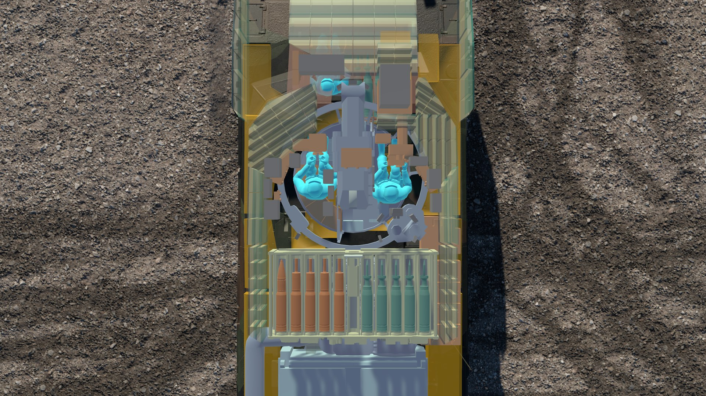
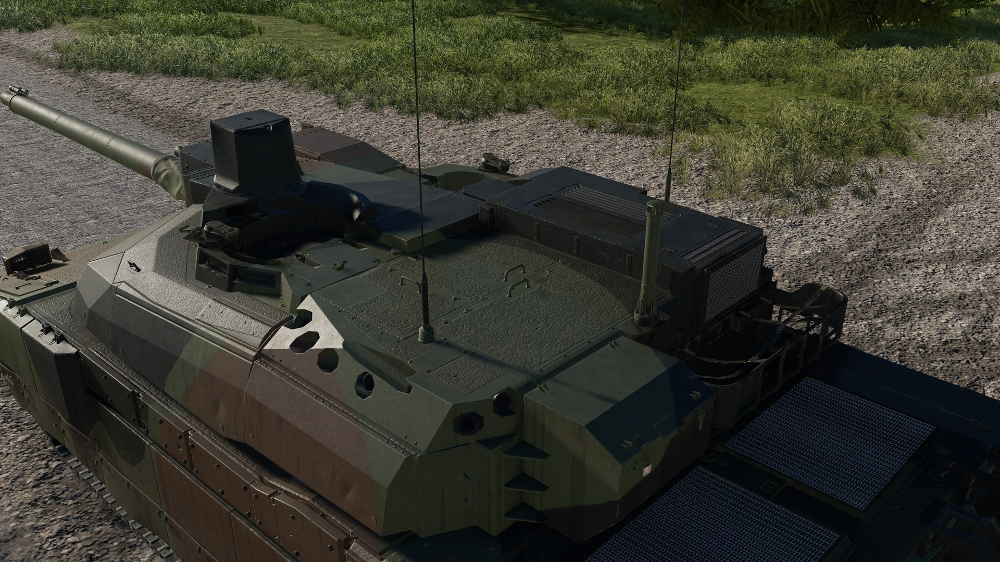

# The armour

How the Leclerc SXXI's armour (blindage) is put together, where the numbers come from and where it goes wrong. The short
version is in the [README](../README.md#armour-protection). The real armour is confidential, so every figure on this page
is my estimate and none of them is a measurement of the tank. The mod's figures are also computed, not fired: a median over
a grid of straight-on lines through the armour table the mod ships (and, for the vanilla tanks, through the game's own
files). The sources are listed at the end of the "Where it isn't the real tank" section of [details.md](details.md).

## War Thunder's shapes, my numbers

The armour pieces, hull and turret, are cut from War Thunder's damage model of the Leclerc SXXI and replace the T-80B's
outer armour. None of War Thunder's armour values is used. Every thickness and strength comes from the French sources
further down, or from my own estimate where they say nothing, and each estimate is listed in
[details.md](details.md#where-it-isnt-the-real-tank). The model's composite packs are filled with a per-mm value that I
solved for the build, so that the figures I chose come out.

In game it's ordinary GHPC armour, the same kind the vanilla tanks use and hit by the same rules. A few parts of
the model aren't armour at all and are skipped: the x-ray sheets (they only draw the compartments for the hit report), the
stowage, the rear box and the inner shells.

Inside it works like a vanilla tank. Engine, transmission, cooling, the breech, both drives, the fire control, the HL 130,
the HL 120 head and the rammer are damageable modules wired into the game's own systems, so knocking one out does what
it does on a vanilla tank. The bustle is its own compartment. The rack is built to vent through the two roof panels
and to leave the crew in front of the bulkhead alive.

  
  

*Left: the hit x-ray from above, the crew (light blue), the modules and the ammo. Right: the bustle roof with its two
blow-off panels and the GALIX tubes.*

## Where the design comes from

The figures come from **French documents and books**, and from what the SXXI was built to stop:

- **The front of the turret:** the SXXI's design threat, from Chassillan's article in Trucks & Tanks 66 (2018) as the
  French wiki quotes it, «porter la protection au niveau souhaité». I set the left cheek at 700 KE / 1100 HEAT.
- **The welded structure:** «armature en plaques d'acier mécanosoudées» with plates of 30 to 50 mm. That's the only
  thickness any source gives, so the plates get 50, 40, 30 or 20 mm by where they are.
- **The bustle boxes:** the French Army's 2012 description of «blindage réactif de type NERA», the maker's brochure and
  what the boxes had to stop, 30 mm armour-piercing, an RPG-7 and 20 mm from above, with ceramic tops. Sources disagree on
  whether they're semi-reactive or explosive, so I treated them as NERA at 120 / 500, which nothing sets off.
- **The embrasure round the gun:** the only source is a GIAT patent (EP0989379) that doesn't name the Leclerc, so treat it with
  suspicion.
- **The right cheek's second pack:** War Thunder's x-ray lays an inner pack beside the gunner, so I kept it. No French
  source backs it.

Where nothing could be found, the value is my own and [details.md](details.md#where-it-isnt-the-real-tank) says so.

## How it compares

Line-of-sight protection straight from the front, in mm of steel:

| | Turret front (vs APFSDS / vs HEAT) | Upper glacis (vs APFSDS / vs HEAT) |
|---|---|---|
| **Leclerc SXXI (this mod), left cheek** | **700 / 1100** | **500 / 800** |
| Leclerc SXXI, right cheek | about 1150 / 1780 | |
| Leclerc SXXI, seam beside the gunner's sight | 184 to 303 / 289 to 409 | |
| Leopard 2A0 to A3 (vanilla) | 403 / 771 | 317 / 661 |
| M1IP (vanilla) | 516 / 999 | 348 / 361 |
| [T-90A](https://github.com/marsattackk/GHPC-T90A) (my mod) | 690 / 819, plus Kontakt-5 (about +140 / +550) | 549 / 748 |

The front side skirts and the sides come to about 160 / 490 (the heavy skirts alone are 120 / 450). Median over a grid of
straight-on lines, taken from the mod's armour table for the Leclerc and from the game's files for the vanilla tanks.

Against the best darts, DM23 at 520 mm, M833 at 480 mm and the T-90A's 3BM60 at about 690 mm, none of them gets through
the left cheek, though the 3BM60 is only 10 mm short of it. Its own OFL 120 F2 at about 800 mm is about 30 mm short of the
T-90A's turret front with Kontakt-5 (about 830). Margins that small are inside my error, so it's a close match and I
wouldn't call a winner. The T-90A's figures are those of release 0.5.0.

## Test firing

The figures above are computed from the armour table, not measured with shots. What I do fire in game are three shots
that check the compartments: one at the turret ring from the left, one from the right, and one at the bustle from behind,
where the round meets the shut bulkhead between the bustle and the crew. I read the damage report for those.

## Weak spots

If you're fighting one, or trying to keep one alive, this is where it goes wrong.

- **The seam beside the gunner's sight block.** About 184 to 303 against APFSDS, the thinnest part of the turret front,
  and the sight block itself is thin too. I left it as a real weak zone.
- **The lower front plate.** It's a 50 mm plate, so don't count on the hull front.
- **The roof and the engine deck,** at 20 to 30 mm, from above or at a steep angle.
- **The bustle.** It's built so that a rack going off vents through the two roof panels and the crew in front of the
  bulkhead lives. I haven't set the rack off on the Leclerc in game.
- **The sponson strips and the roof pockets.** My simple hitboxes leave out some of them, so a round can find less than the
  real tank would give it.
- **The sides.** Skirts and sides together are only about 160 / 490.
