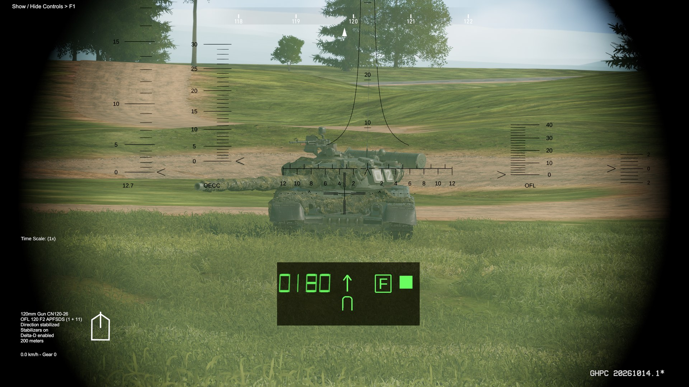
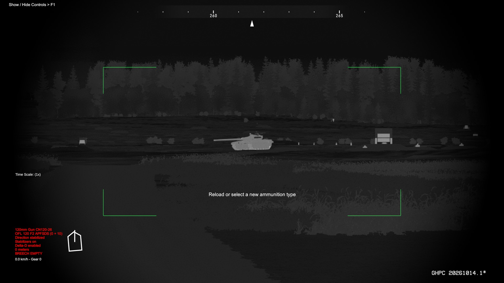
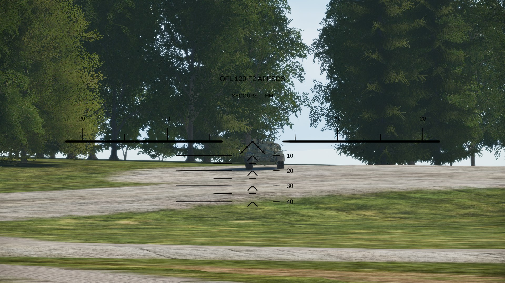

# The Leclerc SXXI in detail

The bits that didn't fit in the [README](../README.md): the comparison with the T-80B it's built on, the sights, the
machine gun and the ammo up close, the numbers, where the mod isn't quite the real tank and what I haven't seen in game yet. The armour has its own page,
[armour.md](armour.md).

## From the T-80B to the Leclerc SXXI

The looks come from War Thunder and so do the shapes of the armour plates, because its damage model is a good map of
where every plate sits. What those plates are worth, and everything else that decides what happens when a round hits,
was built for GHPC with GHPC's own rules.

GHPC has no Leclerc and no French army, so the SXXI is built on the game's T-80B. That's the base you don't see: the rig
the turret and gun hang on, the running gear's physics, the hull internals (resized for a longer hull), the machinery
of the fire control and the laser, the fire suppression and the speed formula. What changed on top:

| | T-80B (in the base game) | Leclerc SXXI (this mod) |
|---|---|---|
| Gun | 125 mm, with the Kobra missile through it | 120 mm CN120-26, 52 calibres, no missile |
| Loading | carousel under the turret | bustle conveyor with 22 rounds, an 18-round drum in the hull |
| Front armour, vs APFSDS (turret / glacis) | 595 / 485 | 700 / 500 |
| Gunner's sight | the T-80B's, no thermal | HL 130, day channel and Iris thermal |
| Commander | free-look head view | the same free-look view, raised over the roof, with the HL 120 head as a still prop. The gunner gets the secours view |
| Smoke | 8 tubes | 14 GALIX tubes |
| Mass | 46.5 t | 57.7 t |
| Crew | commander, gunner, driver | commander, gunner, driver, with no loader |

The hull is 1.08 m longer than the T-80B's and the turret ring smaller (1.92 m against 2.23 m), so almost everything
inside was moved or rebuilt to fit. Where you see or hear the tank, a NATO tank gets NATO parts. The rounds are the
Leopard 2's DM23 and DM12A1 models reshaped and repainted, the gun sound is the Leopard 2's 120 mm and the engine is its
diesel with the T-80's turbine whine laid low under it. The smoke grenade is the Leopard 2's M82, the crew voices and
view marks the M1IP's, the 12.7 mm coax the M1IP's Browning, and the thermal image has the M1IP's scope look. The
army is the M60A1's, which puts it on the American side. The autoloader's sound is put together from the T-72 carousel
motor, the T-80's sounds and the Leopard and Abrams loading sounds, all of them the game's own.

## A bit of history

The SXXI (Série XXI, also called the third series) is the last batch of Leclercs built for the French Army, tranches 10
and 11, about 96 tanks delivered from 2003 to 2007. It kept the HL 130 gunner's sight the later second-series tanks
already had, and added the HL 120 commander's sight with its own thermal camera in place of the old HL 70, add-on armour modules on the turret front and sides, and
from tranche 11 the ICONE tactical computer. All the SXXIs were brought up to the tranche 11 standard from 2007.

The tank in this mod is an SXXI as it served before the XLR upgrade, in the three-tone Centre-Europe camouflage.

## The sights

  
  

*The HL 130's day channel and its Iris thermal.*

**HL 130** (gunner): the day channel at 17.5° / 5.5°. The thermal is the Iris, drawn at 576 lines like the T-90A's ESSA,
in three fields of 6°, 2° and 1° tall, which is x3, x10 and x20. The laser measures out to 6000 m. The reticle was
redrawn from pictures of the real sight, one of them a French diagram with the elements labelled.

- The day reticle has the nominal firing cross and the plate with one range scale for each round: the 12.7 mm
  (échelle de hausse 12,7, out to 2000 m), the OECC (3000 m) and the OFL (4000 m). The scales are driven by the round
  in the gun. Next to them are the stadiametric curves for a 6 m target at 10, 20 and 30, the mil scale and the
  boresight scale, and the emergency mark under the cross.
- The display box under the cross has «HF» (the range in metres, or HF when you haven't lased), the letter of the
  round, F or C, a ready mark and a hull symbol that turns with the hull. The thermal has the cross with hollow bars
  and dots and the same readout without the box.
- The units are French millièmes. 6400 to a turn, the same as NATO mils.
- The pictures show the plate 7.6 to 23.6 mils above the cross and once 10 to its side, while the cross and the box stay
  put, so I read it as the plate showing where the gun is laid. That's my reading, not something a source says.
- Each drop scale's "<" index slides up to the range that's set, read on that round's own scale, and stops at the
  scale's top. No source says what drives it; that's my reading too. The French diagram also shows one fixed on each
  zero, which I left out.
- The plate rises by the round's superelevation from the same table its scales are drawn from. The game's own gun lay
  holds the gun at least 0.1° up out to about a kilometre, which made the plate jump 1.8 mils at the first range.
- A few small marks aren't drawn yet: the bubble level, the corner brackets one thermal picture shows and the dashed
  circle round the cross in two of them.

**HL 120** (commander): the head is on the turret and can be shot off, but it's a still prop. The commander has no
sight of its own, only the free-look view and the night-vision goggles. What the HL 120 gives you is the **secours**:
when the HL 130 is gone the HL 120 head sits fixed and slaved to the gun,
with a day channel at x10, a chevron aiming mark, a range scale for each round in hectometres and the leads in
millièmes. At night it's lit red-orange. There's no laser, no computer and no convergence. Superelevation and lead are
switched off while you're in it, so you read the range off the scale for the round in the gun.

  

## The 12.7 mm coaxial machine gun

The coax is a 12.7 mm M2HB with 950 rounds, in belts of 140: six of 140 and one of 110. Effects, timing and the ammo
assets are the M1IP's 12.7 mm Browning, because the game has the weapon already. It's the only machine gun, the SXXI's
roof gun, the AA NF1 7.62 mm, is hand-laid and normally not fitted, and War Thunder has none.

## The ammo

- **22 in the bustle conveyor** and **18 in the hull drum**. 18 darts, 14 HEAT and 8 HE: 12 / 6 / 4 in the bustle and
  6 / 8 / 4 in the drum.
- The OFL dart is drawn out to 984 mm. The OECC keeps the DM12A1's
  shape. The EXPL has a pointed olive ogive taken from the maker's picture of the HE F1. All of them are made from the
  game's own round models, so they don't look out of place next to the vanilla shells.
- The mission's ammo menu picks the dart. The EXPL's fuze setting, impact or a burst about 3 m above the lased range, is
  in the vehicle menu.

## The paint

Weathered by default. The three-tone Centre-Europe pattern is War Thunder's, recoloured to GHPC's own NATO three-tone so
it sits with the Leopard 2A3 and the Abrams, and the weathering is halved on the mud and brown. `Weathered paint` set to
false gives the clean factory finish.

## Numbers

| | |
|---|---|
| Engine | V8X, 1500 hp at 2500 rpm, 900 at idle |
| Mass | 57.7 t |
| Speed | 72 km/h forward, 40 km/h in the fast reverse gear (13 km/h in the slow one) |
| Gearbox | 5 forward gears, 2 reverse |
| Turret traverse / gun elevation | 40°/s / 30°/s |
| Gun | CN120-26, -8° / +20°, 400 mm recoil |
| Autoloader | 6 s for a reload, 8 s when the round type changes, the gun dipping to -1.8° while it loads |
| Restock | the crew moves a round from the drum to the bustle in about 22 s |
| Main gun ammo | 40 rounds: OFL 120 F2 or F1, OECC 120 F1, 120 EXPL F1 |
| Coax | 12.7 mm M2HB, 950 rounds (belts of 140) |
| Smoke | 14 GALIX tubes, all in one volley |
| Fuel | 1300 l in 10 tanks |
| Crew | 3 |

| Round | Speed | Penetration |
|---|---|---|
| OFL 120 F2 (default) | 1740 m/s | about 800 mm |
| OFL 120 F1 | 1790 m/s | about 700 mm |
| OECC 120 F1 HEAT-MP | 1100 m/s | 560 mm |
| 120 EXPL F1 HE | 1050 m/s | 3.5 kg TNT equivalent |

## Where it isn't the real tank

Some of these are my choices against what the sources would give. They're listed as choices because I made them on
purpose, and I'm not planning to change them back. The rest are places where the sources ran out.

A fair bit of it is my best guess where the French sources ran out. If you've got a real source on any of these I'd
like to see it.

**Things I chose**

- I gave every GALIX tube smoke and all 14 fire in one volley, 7 a side: 5 along the bustle side and 2 at the rear
  corner. The real tank loads four round types (Galix 3 smoke for about 50 s, Galix 13 smoke and infra-red for about 30,
  Galix 6 an infra-red decoy that goes straight up, and Galix 4 fragmentation) and there's no published standard mix.
  The maker's brochure (GIAT, «Leclerc, la supériorité opérationnelle») says 2 × 9 tubes. GHPC only throws smoke, so it's one screen per tank with no restock. The
  grenade is the Leopard 2's M82 at 66 mm, and the rear corner pairs fire back and outward by my best guess.
- The thermal has three fields, x3, x10 and x20, 576 lines, 6°, 2° and 1° tall. The sourced pair is x3 and x10 (9 × 6° and
  3 × 2°, from the HL 60 and Athos), and the x20 at 1.5 × 1° is a zoom of the x10 field because I found no figure for it.
- The laser rangefinder reaches 6000 m, the T-80B's own value, where I'd have guessed 4000 m. Nothing I found says
  either. The limits on the lead (5°), on the laser window (±5° in azimuth) and on the line of sight (-10° to +20°
  relative to the turret) are my guesses as well.
- The right cheek keeps both packs, a front pack and an inner one beside the gunner, as War Thunder's x-ray lays them
  out. It reads about 1150 / 1780 against the left's 700 / 1100, with no cap on the inner pack. No source backs the inner
  pack, and how the protection splits between the two packs comes from the model.
- The fast reverse is 40 km/h, like the vanilla Leopard 2A3 and M1IP. The sourced figure is 38.
- The driver's controls, the trunnion, the turret hydraulics and the loader's casing are in the hit report only, with no
  effect on the game when they're hit.
- The driver's periscopes are off, as on the T-80B, so the driver has no view.
- The hull drum's left round reaches 22 mm into the driver's hit zones. The alternatives were moving the driver by
  2.5 cm or the drum by 22 cm.
- The round mix of 18 / 14 / 8 is mine, 12 / 6 / 4 in the bustle and 6 / 8 / 4 in the drum, because nobody publishes it.
  Only the 40 = 22 + 18 is sourced.
- There's no spall liner because I found no source for one, no roof gun and no OEFC canister round.
- The HL 120 head is a still prop. The real one is the commander's panoramic sight with a day channel and the Iris thermal,
  and here it has no views, no fire-control link and no head drive, so the commander has no sight of his own. Aim
  Override is not wired to it either.
- The HL 120 secours view is a game-side backup. The real Leclerc has no backup gunner's sight and the commander takes
  over through his HL 70 or HL 120. The reticle layout is my own from a forum post describing an emergency reticle (I could only see a summary of it, not the post)
  («réticule secours»), the field is the HL 120's narrow x10 borrowed, the window sits about 0.5 m left and 0.6 m above
  the bore. Cycle View reaches it, and losing the HL 130 switches to it (both seen in game).
- It fights on the US side with American voices, because the game has no French army or French voices. The army is the
  M60A1's and the crew's voices are the M1IP's.
- The commander sits left of the gun and the gunner right, as the French wiki has it. Forecast International says the
  other way round.
- The commander has 7 vision blocks: one forward under the HL 70 or HL 120 head, three on the left and three on the
  right. Two other sources say 8. War Thunder paints the right three over and here they get glass like the others.
- There are two blow-off panels, from War Thunder's lid split along its seam.

**Armour** (the shapes are War Thunder's and the values are mine)

- Turret front 700 KE / 1100 HEAT, the median of the left cheek. That's what the SXXI was designed to resist
  (Chassillan), not a measured figure, because the Leclerc's armour is confidential.
- Glacis 500 / 800, with low confidence. Forum and plan-view estimates for the glacis are 480 to 540 KE.
- The heavy front side skirts 120 KE / 450 HEAT, the light rear skirt panels 6 mm steel, and the rubber skirts at GHPC's
  x0.1 per mm convention. All of that is my estimate.
- The bustle side modules are NERA at 120 / 500 and nothing sets them off. The sources split on what they are: Chassillan
  and the Army say semi-reactive or NERA, the French wiki's table says explosive reactive. I picked the least that stops
  a 30 mm AP round and an RPG-7, which is the stated requirement, and gave the ceramic tops 40 mm.
- The welded plates are 50 mm on the nose, the lower front, the glacis support box, the turret front walls and the ring
  flange, 40 on the sides, 30 on the roofs, rear, floor and sponsons, and 20 on the engine grilles and the rear deck
  cover. The only sourced fact is "30 to 50 mm".
- The gun embrasure has 60 mm plates, a 150 mm block round the bore and a 40 mm shield on the gun. That's from a GIAT
  patent that doesn't name the Leclerc, so I'm not sure of it.
- Other thin or unsourced plates: roof covers 10 mm, sight shutters 15 mm (they're glass-alumina composite covers and I
  have no thickness), stowage boxes 5 mm, the engine bulkhead 10 mm, the front mud deflector 5 mm, the rear boxes 5 mm and
  the crew-to-bustle bulkhead 30 mm.
- The composite per-mm values (turret 0.9435 vs APFSDS and 1.5735 vs HEAT, glacis 0.5801 and 1.055) are solved so that my
  chosen figures come out. They aren't material data.
- The weak seam beside the gunner's sight block (184 to 303 KE and 289 to 409 HEAT), and the sight block itself, are as
  the model lays them out. I left them as a real weak zone.
- There's no mine plate and no AZUR, because they aren't on the SXXI. My simple hitboxes leave out some pockets: the
  turret roof under the right-front plates, round the ring and the sponson strips. They cover about 63, 77, 78 and 79 %
  of the interior as seen from the front fan.
- How the cheek packs look in the x-ray (face, core, backing) is only illustrative.
- The x-ray's compartment volumes are boxes I inferred: the turret in 4 blocks, the hull in 3, the engine in 2 and the
  bustle as one box with a sloping floor.
- The fuel is 1300 l in 10 War Thunder tanks, with no rear drums. It's in the hit report with fuel armour but starts no
  fire. Fire suppression is the T-80B's behaviour.

**Firepower**

- The OFL 120 F1's 696 mm is computed (Lanz-Odermatt on the DM43 rod, 574 × 20.3 mm in tungsten, 1790 m/s, 4.0 kg), on the
  same 60° footing as the T-90A's 3BM60.
- The OFL 120 F2's 800 mm is the F1 plus 15 %, because I don't know the rod. The one source with both figures has the F2
  about 14 % ahead (Jane's 640 against 560 mm at 2 km) and calls its penetration superior.
  1740 m/s and 4.5 kg, and the depleted-uranium density and the loss of 100 m/s at 2 km are my guesses.
- The OECC's 560 mm is GHPC's DM12A1 borrowed, because the French figure of 480 has no known origin. 1100 m/s and 14.4 kg
  are sourced and the filler of 2.21 kg of TNT is not.
- The 120 EXPL F1 uses the vanilla HE penetration, with 3.5 kg of TNT, which is 3 kg of Composite B times the vanilla
  ratio of 1.17. The speed of 1050 m/s and the 16.8 kg are the maker's. The impact or overhead burst setting is a
  gameplay approximation.
- The round models are the Leopard 2's DM23 and DM12A1 repainted as the French photos show: white cases, black bands and
  stencils. The EXPL's case follows the OECC's because I have no photo of it, and the OECC keeps the DM12A1's shape for the
  same reason.
- The gun is the 120 mm CN120-26 at -8° / +20° (Forecast International's report. Others say +15, +17 or +18). The depression over
  the rear deck comes from the model: the barrel stays 1 cm off the hull, down to -1.6° at worst, 166° right of the nose.
- The drives are 40°/s and 30°/s, with medium confidence, from Ferrard and Turbé's book via the French wiki.
- The reload is 6 s for the same type and 8 s on a change, from the same book's "under 6" and "under 8". The gun dips to -1.8°
  while loading and returns to the fire control's aim. Over the rear deck, where it can't reach -1.8°, it loads at the
  deck's limit. That part is my choice, because no source says what the real loader does there.
- The stabiliser and the spread (inertia 0.95, deviation 0.005°) are GHPC's Leopard 2A3 and M1IP, because no source gives
  a usable figure.
- The recoil stroke is 0.40 m, from the sourced "limited to 400 mm". The barrel sits on the T-80B's recoil bone, which has
  a 0.25 m stroke made 0.40.
- The shot sound is the Leopard 2's 120 mm. GHPC has no CN120-26 recording, and I haven't heard it in game yet.
- The restock from the drum to the bustle takes about 22 s a round and pauses while the gun loads. It comes from one
  low-confidence "8 minutes" for a full load. The split into 15 s of retrieval and 7 s of storage is mine, and nothing
  says how a round travels from the drum to the bustle.
- The conveyor, gutter, door, rammer and breech block are drawn from photos and timed to fit inside the 6 and 8 s. The
  hand-load sound plays the Abrams' loader events when loading from the hull racks.
- The loader's seven stage times (indexing 2 s, door 0.64 s and so on) are my own split of the maker's 6 s; the game stretches
  them to 8 s when the round changes. When, inside a reload, the door opens and the rammer and breech block move is my own
  timing too, and the loader's part sizes, travels and colours are my estimates: no drawing or timing of it is published.
- The gun counts as laid for loading within 0.05 deg of its loading angle: my choice.
- The commander's free-look eye sits over his hatch ring where I placed it from the model's hatch. The HL 130 day display's
  green is picked from the pictures; the exact shade is my choice.
- The 12.7 mm coax, 950 rounds in belts of 140, is the maker's figure. Other sources say 800 or 1100. The weapon, effects
  and timing are copied from the M1IP's.
- The blow-off panels have no published thickness or mass: I used 10 mm steel over War Thunder's panel sizes (73 kg at the
  front, 60 kg at the rear), thrown at the M1's speed of 6 m/s with a flame 2 m high and vents the size of the panels. The
  residual fire is 0.5 m for 30 s with the vent flames at half size. Those are gameplay settings.

**Sights**

- The HL 130's day fields of 17.5° / 5.5° are sourced (the French wiki). The thermal's 576 lines follow the same rule as
  the T-90A's ESSA.
- On the HL 130 reticle I didn't draw the bubble level, the thermal's corner brackets, the dashed-circle cross variant,
  the doubling mark or «PC». The plate follows the gun's lay (superelevation and lead) by my guess, and each scale's
  index pointing at the set range is my guess too. The «E» for the HE round has no picture behind it, and the hull symbol's size and place are my
  guess too.
- The secours view's x10 field is the HL 70's narrow one, borrowed, because I found no figure for the HL 120's own.
  The head doesn't turn, so the view always looks where the gun does.
- The gunner's eye is where I worked out the roof window's outlet from the two apertures in the model, 23 mm ahead of
  the shield. The sight head is where War Thunder puts it.
- War Thunder paints the sight windows and periscope panes into its textures, so the glass here is generated: dark
  glass with a near-black prism behind it.
- I haven't yet seen the rear-deck heat through a thermal sight or the secours at night. Cycle View into the secours and
  the switch to it when the HL 130 is lost both work in game.

**Mobility, sound, look**

- The mass is 57.7 t, from a French Army technical sheet via the French wiki. The engine is 1500 hp at 2500 rpm, 900 at idle. The top
  speed of 72 km/h comes from lowering the rig's drag from 0.1 to about 0.072, because the gears can't lift the rig's
  plateau of about 63 km/h. That's a game-scale number.
- The gearbox has 5 forward gears with even ratios I inferred, 5.36, 3.52, 2.32, 1.52 and 1.00, and a final drive of 5.5125.
  There are two reverse gears, a slow one at about 13 km/h that I inferred and the fast one at 40. The reverse speed cap of
  48 km/h is my choice, 20 % over the fast gear, so the game's cruise control has room.
- The acceleration is a tuned game number: the rpm climb is 1500 rpm/s like the Leopard 2A3's diesel, which puts the drive model at
  about 4.8 s to 30 km/h against the maker's "under 6 s to 32". I haven't felt it in game since I changed it.
- The braking is about 5.4 m/s², measured 6.3 to 6.6, a little better than GHPC's Western tanks. The source says up to 7.
- The engine sound is the Leopard 2A3's diesel with the T-80 turbine's whine, high-passed at 1.2 kHz, laid low under it. I
  chose that by ear from mock-ups, since the turbine's sound has nothing written behind it. The gains are 0.45 outside
  and 0.9 inside.
- The heat in thermal sights is the Leopard 2A3's engine-deck heat, with the exhaust hot spot at the rear left outlet. I
  placed that from the model's cup and a rear photo, and made the plume half the T-80B's.
- The running gear is the Leclerc's own wheels and track, following the T-80B's physics wheels, so the suspension travel,
  wheel size and track width are for the look only. The first and last road wheels pass 1 to 3 mm beside a hull block, as
  on War Thunder's model, and the direction the track texture scrolls is my guess.
- The interior follows War Thunder's damage model, with positions marked as inferred where it has no part: the forward
  commander block, the rammer and loading tray and the end of the conveyor. Many module hit boxes are trimmed clear of
  the crew GHPC keeps.
- The autoloader's sound is assembled from stock game sounds, in 6 and 8 s variants. I haven't heard it play in game
  yet. The exterior ones are the interior ones 18.4 dB lower.
- The round cases' lettering, turned 90°, I haven't seen in game yet.

**Not seen in game yet**

Built and checked offline, but I haven't seen or heard these in a game yet: the gun's shot sound, the autoloader's
sound, the lettering on the round cases, the acceleration since I changed it, the rear deck's heat in a thermal sight,
a reload with the gun over the rear deck and the secours view at night. The switch to the secours after the HL 130 is lost I have seen work.

**Sources**

These are the ones the numbers above lean on. Where a page says "the French wiki" it means the first.

- French Wikipedia, [Char Leclerc](https://fr.wikipedia.org/wiki/Char_Leclerc) and
  [GIAT CN120-26](https://fr.wikipedia.org/wiki/GIAT_CN120-26). They cite Ferrard and Turbé, *Le système Leclerc* (Bosquet,
  1992) and Chassillan's articles (*Trucks & Tanks* 66, 2018, and *Char Leclerc: de la guerre froide aux conflits de demain*,
  ETAI, 2005), which I haven't read myself.
- GIAT Industries, «Leclerc, la supériorité opérationnelle» (brochure):
  [PDF](http://docfoualier.free.fr/Armement/Docs/fr_ftech_leclerc.pdf).
- Forecast International, AMX Leclerc: [PDF](https://www.forecastinternational.com/archive/disp_pdf.cfm?DACH_RECNO=454).
- The French Army's page on the
  [Char Leclerc](https://www.defense.gouv.fr/terre/nos-materiels/nos-equipements-terre/vehicules-larmee-terre/vehicules-chars-bataille/char-leclerc)
  and its 2012 [Leclerc description](https://www.unabcc.org/app/download/31421485/LECLERC.pdf).
- *Revue Cavalerie* 02-2016 (rounds): [PDF](https://www.unabcc.org/app/download/24053300/Revue+Cavalerie+02-2016.pdf).
- Nexter ammunition catalogue 2018, pp. 34 to 37, from the
  [Internet Archive](https://web.archive.org/web/20211229103128/https://www.nexter-group.fr/sites/default/files/2020-05/20180604%20Nexter%20-%20Catalogue%20Ammunition.pdf).
- English Wikipedia, [120×570mm NATO](https://en.wikipedia.org/wiki/120%C3%97570mm_NATO) (the darts' figures, quoting
  Jane's) and [Leclerc (tank)](https://en.wikipedia.org/wiki/Leclerc_tank).
- Patent EP0989379 ([turret armour](https://patents.google.com/patent/EP0989379A1/fr)) and EP0467754
  ([the automatic loader](https://patents.google.com/patent/EP0467754A1/fr)).
- The SESM [ESM 500 transmission sheet](https://www.armyrecognition.com/images/stories/customer/sesm/pdf/ESM_500.pdf) and
  Armedconflicts' [Leclerc page](https://www.armedconflicts.com/Leclerc-t11932).

## What it shares with my T-80UM2

The Leclerc and my [T-80UM2](https://github.com/marsattackk/GHPC-T80UM2) are built on the same game tank, so they share
the rig, the machinery of the fire control and the running gear's physics. That's where it ends. The Leclerc is a
different tank with its own armour, loading, sights and sounds, and it has none of the T-80UM2's settings. The bustle is
laid out like the one I built for the [T-90M](https://github.com/marsattackk/GHPC-T90M), its own compartment with
blow-off panels and a residual fire, and the Leclerc's paint, thermal heat and smoke work the way they do on my other
tanks. It's still its own mod and none of them needs another.
